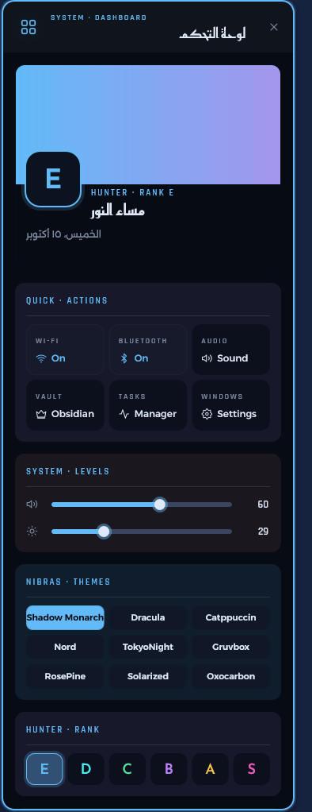
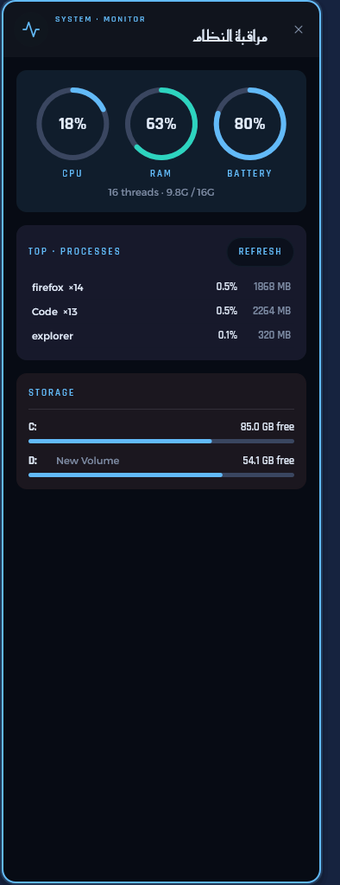
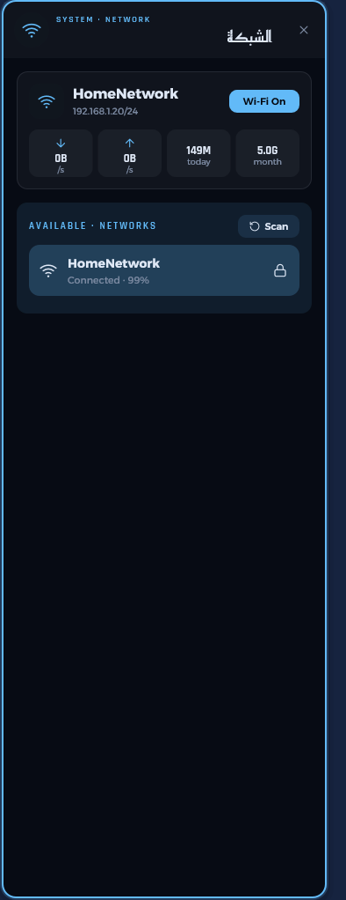
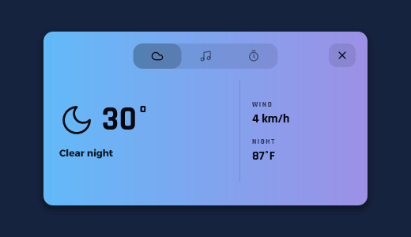

# Monarch Next

A complete Windows 11 desktop shell in **pure Rust**: top bar, smart capsule, side panels, tiling
window manager, wallpaper engine, system tray, launcher and a Gemini assistant — in **one 2.6 MB
executable** with no runtime dependencies (no browser engine, no WebView, no Node, no local server,
no helper programs).

The look follows the *Shadow Monarch* (Solo Leveling) theme and the layout of
[NibrasShell](https://github.com/AhmedSaadi0/NibrasShell). Arabic and English are both first-class.

<p>

</p>
<p>



</p>
<p>


</p>

## Features

| Area | |
|---|---|
| **Top bar** | tray icons, network rates, active window, CPU/RAM/battery rings, workspaces with app icons |
| **Capsule** | clock & date; weather, media and focus-timer cards; notices for volume, brightness, battery, charging, track changes and alerts |
| **Left bar + panels** | dashboard (Wi-Fi/Bluetooth, volume/brightness, themes, ranks, wallpapers), notifications, weather, system monitor, Wi-Fi manager, clipboard history, to-do, power, settings, Gemini assistant |
| **Window manager** | tiling with gaps, 10 workspaces + a special one, app rules, focus-follows-mouse, Win+drag to move/resize, crash-safe hiding |
| **Keyboard** | 63 shortcuts (Win+/ shows them all) |
| **Launcher** | Win+R: fuzzy app search, calculator, web search |
| **Wallpaper** | per-rank folders, rotation, clock layer, accent colour taken from the image, glowing active window |
| **System** | hides the Windows taskbar, reserves screen space, starts with Windows, restarts itself after a crash, restores everything on exit or uninstall |

## Install

1. Download `MonarchNext-Setup.exe` from the [Releases](../../releases) page.
2. Run it. A short setup asks for your name, your wallpapers folder, your city (for weather), an
   optional Obsidian focus-timer file, your rank colour, and which parts to enable (window tiling,
   hiding the taskbar, wallpaper engine, start with Windows).
3. Done — the shell starts. No administrator rights needed. Everything can be changed later from
   the Settings panel; running the setup again updates in place and keeps your settings.

Uninstall from *Settings → Apps → Monarch Next*; the Windows taskbar comes back as it was.

Quick start in Arabic: [QUICKSTART-AR.md](QUICKSTART-AR.md) · Problems: [docs/TROUBLESHOOTING.md](docs/TROUBLESHOOTING.md)

## Performance

2 processes, ~0.03 % CPU and ~34 MB of memory at idle, first paint in ~130 ms —
compared with 20 processes and ~950 MB for the multi-tool setup it replaced.
Details: [docs/PERFORMANCE.md](docs/PERFORMANCE.md).

## Build

```powershell
./build.ps1 -Test    # tests + release build → dist/MonarchNext-Setup.exe
```

Requires stable Rust on Windows (`x86_64-pc-windows-msvc`, or the GNU toolchain with WinLibs).

- `crates/core` — pure logic with unit tests (layout tree, shortcuts, launcher, usage, focus timer…)
- `crates/desktop` — the shell: Direct2D/DirectWrite renderer, surfaces, runtime, subsystems, installer

How it fits together: [docs/ARCHITECTURE.md](docs/ARCHITECTURE.md).

## License

MIT © EsamLasheen. Bundled fonts are under the SIL Open Font License; icons derive from Lucide (ISC).
